# Satellite-Guided Multi-Stage Allocation of Primary Healthcare in Mwanza, Tanzania

> Deep-learning land-use classification of Sentinel-2 imagery feeding two linked integer-programming models that decide **where to build** new dispensaries (Year 1) and **where to add staff or upgrade** facilities (Year 2).

**Course:** DSAI 6220 Advanced Machine Learning, Mini Project (Group 1)
**Institution:** The Nelson Mandela African Institution of Science and Technology (NM-AIST), MSc Data Science and AI
**Live demo:** <https://mwanza-allocation-app-k6phb8vzyoxgccyrn36bwp.streamlit.app/>

| Headline result | Value |
|---|---|
| CNN test accuracy (EuroSAT, 10 classes) | **95.9%** (macro F1 0.957) |
| CNN transfer to Mwanza (AUC vs. Google Open Buildings) | **0.913** |
| Population within 5 km of care | **97.6% → 99.5%** with 6 new dispensaries |
| Capacity gap after Stage 1 | **91,216 → 0** people with a 16-unit Year-2 budget |
| Optimized vs. "most-populated-first" (Stage 1) | **2.4×** more underserved people covered |
| Linked vs. myopic Stage 2 plan (same budget) | **0 vs. 2,441** people left unserved |

---

## Contents

1. [The problem](#1-the-problem)
2. [Architecture](#2-architecture)
3. [Data](#3-data)
4. [Methodology](#4-methodology)
5. [Results](#5-results)
6. [Interactive dashboard](#6-interactive-dashboard)
7. [Technologies](#7-technologies)
8. [Project status: completed vs. ongoing](#8-project-status-completed-vs-ongoing)
9. [Limitations](#9-limitations)
10. [Repository layout](#10-repository-layout)
11. [How to run](#11-how-to-run)
12. [References](#12-references)

---

## 1. The problem

Health budgets cannot reach everyone at once, so planners have to decide what to fund first and what to fund next. Tanzania's policy target is for every household to be **within 5 km of a health facility**, but facilities cluster in towns, and census-based maps of where people live are updated only once a decade.

The project asks two linked questions for a 55 km × 55 km area around Mwanza city on the southern shore of Lake Victoria:

1. **Access (Year 1):** given a budget of *K* new dispensaries, where should they go so the most people who currently live more than 5 km from care are brought within reach?
2. **Capacity (Year 2):** given the facilities that now exist, including the new ones, how should a budget of *B* units be split between extra clinicians and dispensary-to-health-centre upgrades so the fewest people are left without a facility that has room for them?

The two stages are linked: every dispensary built in Year 1 attracts patients and changes the load that Year 2 must handle. Satellite imagery provides the evidence for both: it shows where people live and which land a facility can be built on.

---

## 2. Architecture

### 2.1 End-to-end pipeline

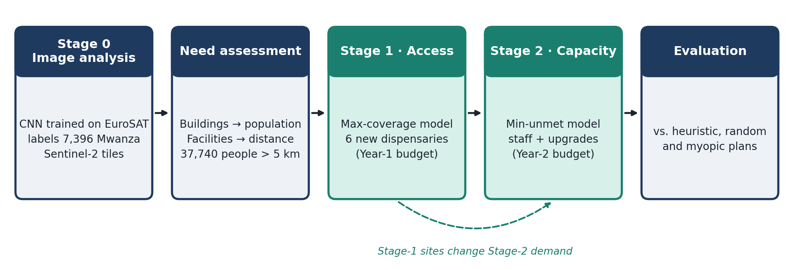

```mermaid
flowchart LR
    subgraph S0["Stage 0 · Image analysis"]
        A1[EuroSAT RGB<br/>27,000 labelled tiles] --> A2[EfficientNetB0<br/>transfer learning]
        A3[Sentinel-2 L1C<br/>254 scenes, Jun–Sep 2025] --> A4[Cloud Score+ mask<br/>+ median composite]
        A4 --> A5[86 × 86 grid<br/>7,396 tiles of 640 m]
        A2 --> A6[Land-use label,<br/>confidence, P&#40;Residential&#41;]
        A5 --> A6
    end

    subgraph NA["Need assessment"]
        B1[Google Open Buildings<br/>364,622 footprints] --> B2[Buildings per tile × 4.3<br/>= population]
        B3[HOT OSM health facilities<br/>157 after cleaning] --> B4[Distance to nearest<br/>facility per tile]
        B2 --> B5[Underserved tiles<br/>populated and > 5 km]
        B4 --> B5
    end

    subgraph OPT["Optimization (PuLP + CBC)"]
        C1[Stage 1 · Access<br/>Maximal covering model<br/>choose K sites on land]
        C2[Stage 2 · Capacity<br/>Mixed-integer model<br/>clinicians + upgrades ≤ B]
    end

    A6 -- validated against --> B1
    A6 -- exclude water tiles --> C1
    B5 --> C1
    C1 -- new dispensaries become<br/>Stage 2 supply --> C2
    B2 --> C2
    C1 --> E[Evaluation vs.<br/>heuristic, random,<br/>myopic baselines]
    C2 --> E
    C2 --> D[Streamlit dashboard<br/>re-solves both stages live]
```

### 2.2 Data flow between notebook and dashboard

The notebook runs in Google Colab and persists every intermediate table to Google Drive (`MyDrive/mwanza_project/`), so the long-running steps (CNN training, Earth Engine exports) never have to be repeated. The dashboard reads only the two final tables.

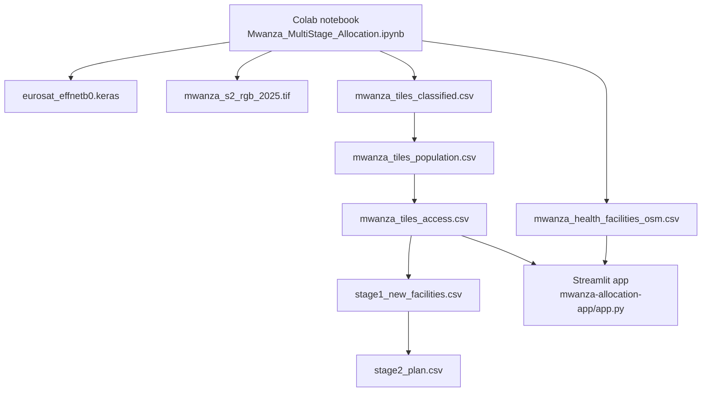

---

## 3. Data

| Dataset | Content | Role |
|---|---|---|
| EuroSAT RGB (Helber et al., 2019) | 27,000 labelled Sentinel-2 tiles, 64 × 64 px, 10 classes | Train and test the CNN |
| Sentinel-2 Level-1C (`COPERNICUS/S2_HARMONIZED`), Jun–Sep 2025 | 254 scenes via Google Earth Engine, 10 m | Real imagery of Mwanza |
| Google Cloud Score+ | Per-pixel clear-sky score | Cloud masking (keep `cs_cdf ≥ 0.60`) |
| Google Open Buildings v3 | 364,622 footprints (confidence ≥ 0.75, area ≥ 15 m²) | Population estimate and independent CNN validation |
| HOT OpenStreetMap health facilities (HDX) | 157 facilities after cleaning (108 dispensaries/clinics, 12 health centres, 37 hospitals) | Existing supply of care |
| 2022 Tanzania Population and Housing Census | Mean household size 4.3 | Converts buildings to people |

**Study area:** 32.70–33.20° E, 2.35–2.85° S (≈ 55 km × 55 km), projected to UTM zone 36S (EPSG:32736), so every 64 × 64 px tile is exactly 640 m × 640 m.

Two processed tables ship with the repository under [`mwanza-allocation-app/data/`](MwanzaMultiStageAllocation/mwanza-allocation-app/data/):

- `mwanza_tiles_access.csv`: 7,396 rows, one per tile: `row, col, x_m, y_m, lon, lat, land_class, confidence, p_residential, buildings, population, dist_km, underserved`
- `mwanza_health_facilities_osm.csv`: 157 rows: `name, amenity, lat, lon, x_m, y_m, level`

The raw GeoTIFF, building export and HOT zip files are **not** in the repository; they live on Google Drive (see [How to run](#11-how-to-run)).

---

## 4. Methodology

### 4.1 Stage 0: CNN land-use classification

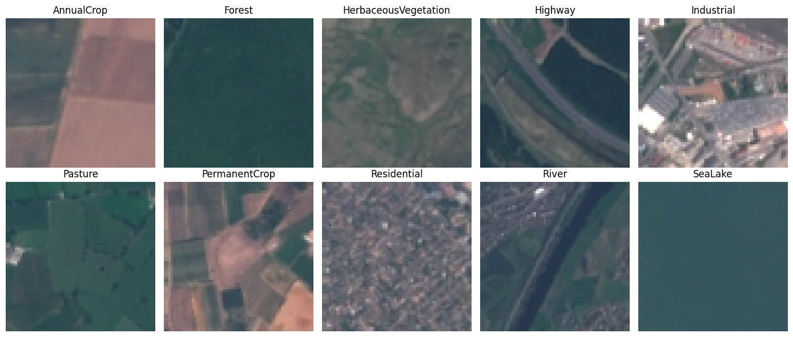

- **Split:** EuroSAT stratified 70 / 15 / 15 → 18,900 train, 4,050 validation, 4,050 test (`random_state=42`).
- **Model:** EfficientNetB0 pre-trained on ImageNet, original head removed → GlobalAveragePooling → Dropout(0.3) → Dense(10, softmax). Inputs upsampled 64 → 128 px.
- **Augmentation:** horizontal and vertical flips (satellite images have no natural "up"), RandomContrast(0.15) and RandomBrightness(0.1), so the model relies less on European colours and soils.
- **Training:**
  - Phase A: backbone frozen, Adam 1e-3, 5 epochs.
  - Phase B: last 40 backbone layers unfrozen, Adam 1e-5, batch norm kept in inference mode, early stopping on validation loss (patience 3), 8 epochs, then continued for 10 more because validation was still improving.
- **Hardware:** Google Colab T4 GPU, TensorFlow 2.20.

### 4.2 Applying the CNN to Mwanza

1. In Earth Engine, 254 Level-1C scenes (the same processing level as EuroSAT) were cloud-masked with Cloud Score+ and combined into a median composite.
2. The composite was exported as an 8-bit RGB GeoTIFF (B4/B3/B2, 0–3000 stretch) at 10 m in UTM 36S: 5,560 × 5,528 px.
3. It was cut into an 86 × 86 grid. Tiles with more than 10% empty pixels were dropped, leaving **7,396 tiles**.
4. **Domain-shift check:** mean RGB was Mwanza `[93.5, 90.3, 97.2]` vs. EuroSAT `[87.9, 96.7, 103.9]`. The 6–7 level difference was judged small enough to skip colour correction.
5. Each tile received a predicted class, a confidence and a Residential probability.

### 4.3 Validation, population and access

- **Independent validation:** buildings were counted per tile from Open Buildings. If the CNN transfers, Residential tiles should hold many buildings, and `p_residential` should separate "settled" tiles (≥ 50 buildings) from the rest. This was measured with ROC-AUC and Spearman ρ.
- **Population:** `population = buildings × 4.3`.
- **Facilities:** points and polygons from HOT OSM. Pharmacies, dentists, labs and drug shops (*duka la dawa*) were removed, duplicates with the same name within 250 m were merged, and each facility was given a level (Hospital / Health Centre / Dispensary-Clinic) from its name (English and Swahili) and OSM tag.
- **Access:** straight-line distance from each tile centre to the nearest facility (`scipy.spatial.cKDTree`). A tile is **underserved** if it is populated and more than 5 km from care.

### 4.4 Stage 1: access (maximal covering location problem)

Demand set *I* = underserved tiles (458). Candidate sites *J* = **land** tiles (the CNN's SeaLake/River labels are excluded) within 5 km of at least one underserved tile (2,837). *N(i)* = candidates within 5 km of tile *i*.

$$
\max \sum_{i \in I} p_i\, y_i \quad\text{s.t.}\quad y_i \le \sum_{j \in N(i)} x_j \;\; \forall i,\qquad \sum_{j \in J} x_j \le K,\qquad x_j, y_i \in \{0,1\}
$$

Solved for K = 1…10 to trace the diminishing-returns curve. **K = 6** was chosen as the largest budget at which every added dispensary still reaches at least 2,500 people.

### 4.5 Stage 2: capacity (mixed-integer model)

The six Stage 1 dispensaries are added to the 157 existing facilities (163 in total). People in tile *i* may use any of their **5 nearest facilities within 5 km**. If none is within 5 km, they may use only the nearest one.

Decision variables: `send[i,f] ≥ 0`, `unmet[i] ≥ 0`, `staff[f] ∈ {0..4}` (integer), `upg[f] ∈ {0,1}` (dispensaries only).

$$
\min \sum_i \text{unmet}_i + 0.001\sum_f (c_s\,\text{staff}_f + c_u\,\text{upg}_f)
$$

subject to

- each tile's population is fully sent or recorded as unmet;
- facility load ≤ base capacity + 5,000·staff + 40,000·upg;
- total spend ≤ B.

The 0.001 weight acts as a lexicographic tie-breaker: fewest unserved people first, then cheapest plan.

| Assumption (set by the team; replaceable by official figures) | Value |
|---|---|
| Base capacity: dispensary / health centre / hospital | 10,000 / 50,000 / 150,000 people |
| Extra clinician | 1 unit → +5,000 capacity (max 4 per facility) |
| Upgrade dispensary → health centre | 6 units → +40,000 capacity |

### 4.6 Evaluation against baselines (equal budgets)

| Stage | Baselines |
|---|---|
| Stage 1 (6 sites) | Most-populated underserved tiles first; random land sites (mean of 200 draws) |
| Stage 2 (16 units) | 1 clinician to each of the 16 busiest facilities; 1 clinician to 16 random facilities (mean of 20); **myopic** plan optimized as if Stage 1 had never happened, then applied to the real network |

Every Stage 2 plan is scored with the same LP (fixed capacities, people routed optimally) for a fair comparison.

---

## 5. Results

All numbers below come from the executed notebook outputs.

### 5.1 CNN on EuroSAT

| Metric | Value |
|---|---|
| Validation accuracy after Phase A (frozen) | 93.2% |
| Best validation accuracy after fine-tuning | 94.9% |
| **Test accuracy** (4,050 unseen images) | **95.9%** |
| Macro precision / recall / F1 | 0.958 / 0.957 / 0.957 |
| Residential precision / recall / F1 | 0.976 / **0.998** / 0.987 |

<details>
<summary>Per-class test report</summary>

| Class | Precision | Recall | F1 | Support |
|---|---|---|---|---|
| AnnualCrop | 0.936 | 0.938 | 0.937 | 450 |
| Forest | 0.965 | 0.989 | 0.977 | 450 |
| HerbaceousVegetation | 0.952 | 0.960 | 0.956 | 450 |
| Highway | 0.940 | 0.920 | 0.930 | 375 |
| Industrial | 0.987 | 0.979 | 0.983 | 375 |
| Pasture | 0.923 | 0.923 | 0.923 | 300 |
| PermanentCrop | 0.953 | 0.920 | 0.936 | 375 |
| Residential | 0.976 | 0.998 | 0.987 | 450 |
| River | 0.957 | 0.952 | 0.955 | 375 |
| SeaLake | 0.987 | 0.987 | 0.987 | 450 |

</details>

| Training curves (dashed = start of fine-tuning) | Normalised confusion matrix |
|---|---|
| 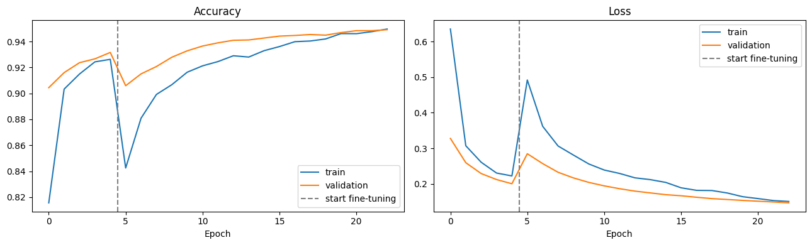 | 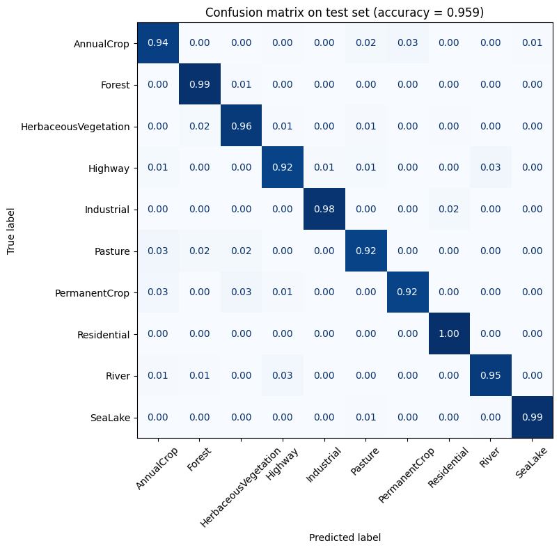 |

Training and validation curves converge without diverging, so there is no sign of overfitting. The only Residential confusion is 0.2% with Industrial, which also contains roofs.

### 5.2 Land-use map of Mwanza

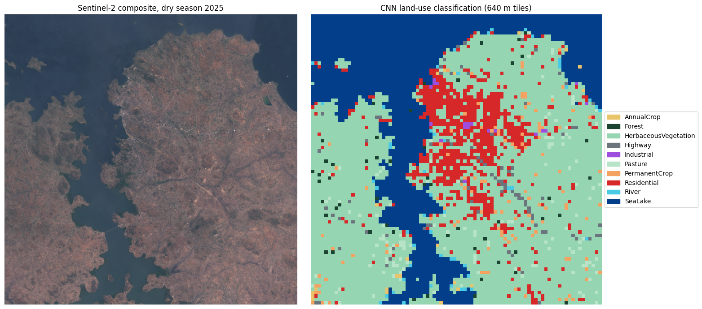

| Class | Tiles | Area (km²) | Share |
|---|---|---|---|
| HerbaceousVegetation | 4,050 | 1,658.9 | 54.8% |
| SeaLake | 2,133 | 873.7 | 28.8% |
| Residential | 732 | 299.8 | 9.9% |
| Other 7 classes | 481 | 197.0 | 6.5% |

Mean prediction confidence: **0.894**. Lake Victoria and the urban peninsula are captured cleanly. Most rural land is labelled HerbaceousVegetation, because small dry-season Tanzanian farms look unlike EuroSAT's large European fields.

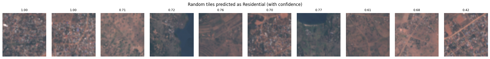

### 5.3 Does a Europe-trained CNN work in Mwanza?

| Check against Google Open Buildings | Value |
|---|---|
| ROC-AUC, `p_residential` vs. settled tiles (≥ 50 buildings) | **0.913** |
| Spearman ρ, `p_residential` vs. building count | **0.747** |
| Mean buildings per tile: Residential / HerbaceousVeg. / SeaLake | 294.8 / 30.0 / 1.5 |

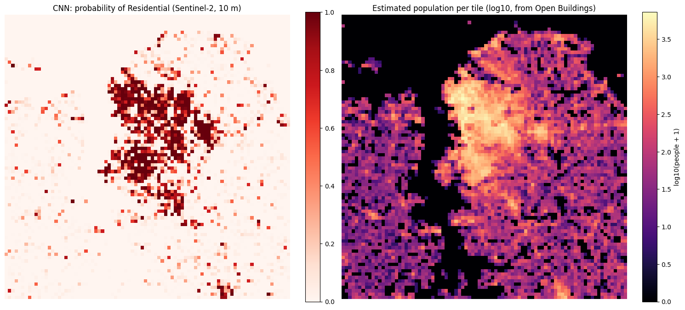

The CNN finds dense settlement well but under-detects scattered rural homes. For that reason, population comes from building counts rather than from CNN labels, which keeps rural people (often the most underserved) visible.

### 5.4 Access gap

| | Value |
|---|---|
| Buildings matched to tiles | 361,890 of 364,622 (99.3%) |
| Estimated population | **1,556,153** |
| Within 5 km of care | 1,518,413 (**97.6%**) |
| Underserved (> 5 km) | **37,740** (2.4%) in 458 tiles |

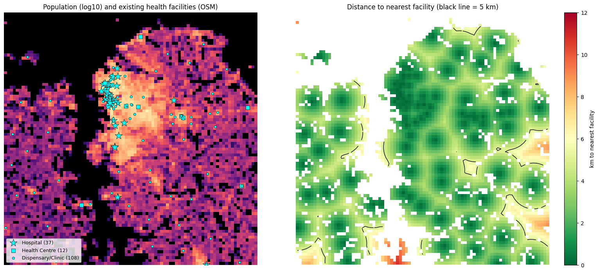

### 5.5 Stage 1: where to build

| K | 1 | 2 | 3 | 4 | 5 | **6** | 7 | 8 | 9 | 10 |
|---|---|---|---|---|---|---|---|---|---|---|
| Underserved people covered | 10,132 | 16,186 | 21,174 | 24,648 | 27,542 | **30,243** | 32,660 | 34,345 | 35,889 | 36,518 |
| % of underserved | 26.8 | 42.9 | 56.1 | 65.3 | 73.0 | **80.1** | 86.5 | 91.0 | 95.1 | 96.8 |

| Diminishing returns | Final plan (K = 6) |
|---|---|
| 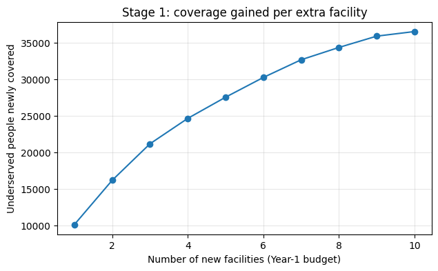 | 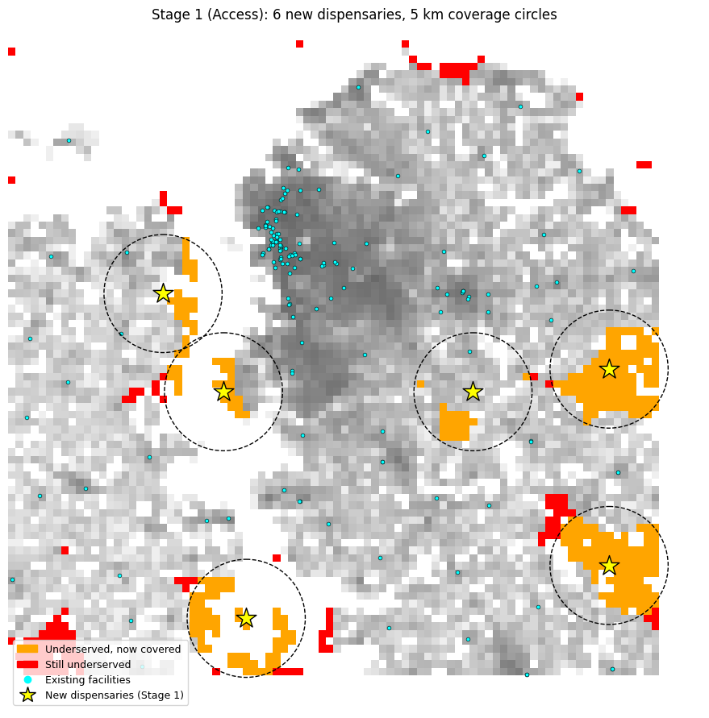 |

With K = 6, the underserved population falls from **37,740 to 7,497**, and 5 km access rises from **97.6% to 99.5%**. All six sites lie on land the CNN labelled HerbaceousVegetation (open land).

| Site | Lat | Lon | Underserved within 5 km |
|---|---|---|---|
| S1-5 | −2.7639 | 33.1576 | 10,132 |
| S1-2 | −2.6134 | 33.1576 | 6,054 |
| S1-1 | −2.5555 | 32.8179 | 4,473 |
| S1-3 | −2.6308 | 32.8640 | 4,088 |
| S1-6 | −2.8045 | 32.8812 | 2,894 |
| S1-4 | −2.6308 | 33.0540 | 2,701 |

### 5.6 Stage 2: staff or upgrade

After Stage 1, **91,216 people** (about 6% of the population, mostly in the peri-urban belt east of the centre) depend on facilities that are over assumed capacity. That gap is invisible to a distance-only analysis.

| Year-2 budget (units) | 0 | 2 | 4 | 6 | 8 | 10 | 12 | 14 | **16** |
|---|---|---|---|---|---|---|---|---|---|
| People still unserved | 91,216 | 81,216 | 71,216 | 51,216 | 41,216 | 31,216 | 12,441 | 2,441 | **0** |

| Budget curve (stepped by 6-unit upgrades) | Final plan at 16 units |
|---|---|
| 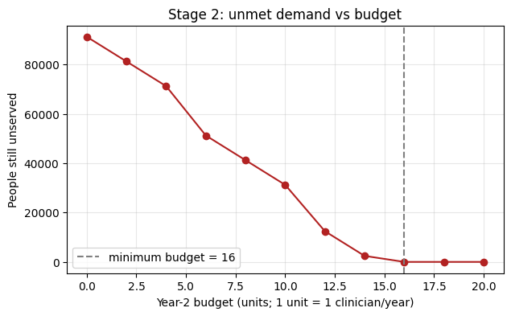 | 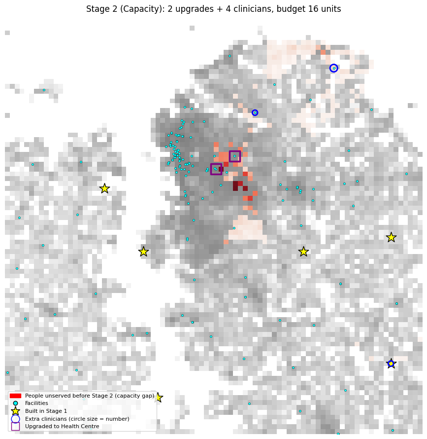 |

| Facility | Built in | Action | Units | People served |
|---|---|---|---|---|
| Mwanza Dispensary | Existing | Upgrade → health centre | 6 | 45,778 |
| Nyerere Dispensary | Existing | Upgrade → health centre | 6 | 50,000 |
| Lutale Dispensary | Existing | +2 clinicians | 2 | 20,000 |
| Igogwe Dispensary | Existing | +1 clinician | 1 | 15,000 |
| **New Dispensary S1-1** | **Stage 1** | +1 clinician | 1 | 11,859 |
| **Total** | | 2 upgrades + 4 clinicians | **16** | gap 91,216 → **0** |

> **Key finding:** New Dispensary S1-1, built in Year 1, serves 11,859 people against a base capacity of 10,000 and needs a clinician in Year 2. A building decision created a staffing need, so the stages cannot be planned independently.

### 5.7 Optimization vs. simpler strategies

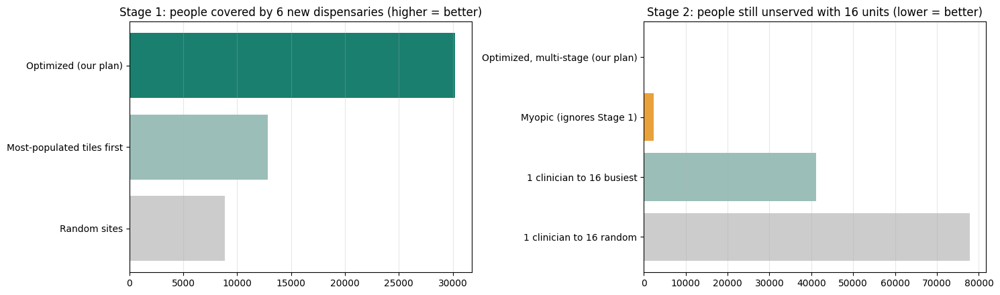

| Stage | Strategy | Result | vs. optimized |
|---|---|---|---|
| Stage 1 (6 sites) | **Optimized (MCLP)** | **30,243 covered** | — |
| | Most-populated tiles first | 12,853 covered | 2.4× fewer |
| | Random land sites (mean of 200) | 8,828 covered | 3.4× fewer |
| Stage 2 (16 units) | **Optimized, multi-stage** | **0 unserved** | — |
| | Myopic (ignores Stage 1) | 2,441 unserved | +2,441 |
| | 1 clinician to 16 busiest | 41,216 unserved | +41,216 |
| | 1 clinician to 16 random (mean of 20) | 77,787 unserved | +77,787 |

The "most-populated first" rule fails because the top tiles sit next to each other, so their 5 km circles overlap and count the same people repeatedly. The myopic plan's shortfall is small (0.16% of the population), but it comes at zero extra cost.

---

## 6. Interactive dashboard

[`MwanzaMultiStageAllocation/mwanza-allocation-app/`](MwanzaMultiStageAllocation/mwanza-allocation-app/) is a Streamlit app that loads the tile and facility tables and **re-solves both optimization stages live** with PuLP/CBC whenever the controls change. Results are cached per parameter set.

<!-- Add a screenshot of the running dashboard here, e.g. docs/images/dashboard.png -->

| Page | What it shows |
|---|---|
| Overview | KPI cards (tiles, population, facilities, CNN accuracy, underserved, covered, access %) and maps |
| Image Analysis | CNN land-use map and class breakdown |
| Access Gap | Population, facilities and distance-to-care maps |
| Stage 1 · Access | Chosen sites, coverage before and after, and comparison with baseline rules |
| Stage 2 · Capacity | Clinician and upgrade plan, unmet demand map, spend |

| Sidebar control | Range | Default |
|---|---|---|
| Scenario preset | Recommended (6, 16) · Tight (3, 8) · Generous (10, 30) · No intervention · Custom | Recommended |
| New dispensaries (Year 1) | 0–10 | 6 |
| Budget units (Year 2) | 0–40 | 16 |
| Access target | 3–10 km | 5 km |
| Year-2 budget may buy | Clinicians and upgrades · Clinicians only · Upgrades only | both |

Deployed at: <https://mwanza-allocation-app-k6phb8vzyoxgccyrn36bwp.streamlit.app/>

---

## 7. Technologies

| Area | Tools |
|---|---|
| Deep learning | TensorFlow / Keras 2.20, EfficientNetB0 (ImageNet weights), `tf.data` |
| Datasets | `torchvision.datasets.EuroSAT` (download only) |
| Remote sensing | Google Earth Engine (`earthengine-api`), `geemap`, `rasterio`, Sentinel-2, Cloud Score+, Open Buildings |
| Geospatial | `geopandas`, `pyproj`/`rasterio.warp`, `scipy.spatial.cKDTree` |
| Optimization | `PuLP` 3.3 with the CBC MILP solver |
| Evaluation | `scikit-learn` (classification report, confusion matrix, ROC-AUC), `scipy.stats.spearmanr` |
| Visualisation | `matplotlib` (notebook), `plotly` (dashboard) |
| App and deployment | `Streamlit` 1.64, Streamlit Community Cloud |
| Compute | Google Colab (T4 GPU), Google Drive for persistence |

---

## 8. Project status: completed vs. ongoing

### ✅ Completed and reported

These results are produced by the executed notebook and appear in the report and slides.

- [x] EuroSAT CNN trained, fine-tuned and evaluated on a held-out test set (95.9%)
- [x] Cloud-free 2025 Sentinel-2 composite of Mwanza built and exported
- [x] 7,396-tile land-use map produced
- [x] CNN validated in Mwanza against Open Buildings (AUC 0.913, ρ 0.747)
- [x] Building-based population estimate and 5 km access gap computed
- [x] Stage 1 MCLP solved for K = 1–10; final plan at K = 6
- [x] Stage 2 MILP solved across budgets; minimum gap-closing budget found (16 units)
- [x] Comparison against heuristic, random and myopic baselines
- [x] Written report, slide deck and deployed Streamlit dashboard

### 🧪 Exploratory: available in the dashboard, not part of the reported results

The dashboard can run these scenarios, but their outputs have **not** been analysed, validated or written up:

- Sensitivity to the access threshold (3–10 km instead of the 5 km policy target)
- Restricting the Year-2 budget to clinicians only or upgrades only
- Preset scenarios other than the recommended (6, 16) plan

### 🔭 Planned / not started

- Replace assumed capacities and costs with official data (Health Facility Registry, DHIS2)
- Use road-network travel time instead of straight-line distance
- Fine-tune the CNN on hand-labelled Mwanza tiles, or try higher-resolution or multi-label models, to improve rural settlement detection
- Add more stages (roads, outreach or mobile clinics for the remaining 7,497 scattered underserved people) and other sectors (e.g. schools)
- Include facilities just outside the study box to remove edge effects

---

## 9. Limitations

- **Domain shift:** the CNN was trained on European imagery. It under-detects scattered rural homes, cannot separate small farms from natural vegetation, and gives mixed tiles a single label.
- **Population proxy:** buildings × 4.3 assumes one household per building. The estimate is best read as *relative* demand.
- **Facility data:** OpenStreetMap is crowd-sourced. Missing rural dispensaries would overstate need.
- **Distances and capacities:** straight-line distance understates real travel. Capacities and costs are team assumptions, so a "capacity shortage" means demand exceeds *assumed* capacity, not measured under-staffing.
- **Edge effects:** facilities just outside the study box are ignored.
- **Reproducibility:** the notebook is Colab-specific (Drive mounts, interactive Earth Engine auth) and depends on intermediate files that are not in this repository.

---

## 10. Repository layout

```
.
├── README.md                                   ← this file
├── docs/images/                                ← figures used in this README (exported from notebook/report)
├── Mwanza_MultiStage_Allocation.ipynb          ← full pipeline (Colab), with outputs
├── Mwanza_MultiStage_Allocation_Report.docx    ← written report
├── Mwanza_MultiStage_Allocation_Presentation.pptx
├── MwanzaMultiStageAllocation/
│   └── mwanza-allocation-app/                  ← Streamlit dashboard
│       ├── app.py
│       ├── requirements.txt
│       ├── logo.png
│       └── data/
│           ├── mwanza_tiles_access.csv
│           └── mwanza_health_facilities_osm.csv
├── submission/ , submission.zip , Assignment - 4.zip   ← course submission bundles (identical copies)
```

The notebook and report at the root, in `MwanzaMultiStageAllocation/` and in `submission/` are byte-identical copies.

---

## 11. How to run

### Dashboard (local, about 2 minutes)

```bash
cd MwanzaMultiStageAllocation/mwanza-allocation-app
pip install -r requirements.txt
streamlit run app.py
```

The two CSVs it needs are already in `data/`. CBC ships with PuLP, so no separate solver install is required.

### Full pipeline (Google Colab)

1. Open `Mwanza_MultiStage_Allocation.ipynb` in Colab and select a **T4 GPU** runtime.
2. Have a Google Earth Engine–enabled Cloud project and replace the project ID in `ee.Initialize(project=...)`.
3. Download the HOT OSM Tanzania health-facility exports (`hotosm_tza_health_facilities_points_geojson.zip`, `..._polygons_geojson.zip`) from [HDX](https://data.humdata.org/dataset/hotosm_tza_health_facilities) into `MyDrive/mwanza_project/`.
4. Run Steps 1–6 (CNN training takes about 10 minutes on a T4, then the Sentinel-2 export). Wait for the Earth Engine export task to reach `COMPLETED`.
5. Run Step 8 (Open Buildings export) and wait for it to complete.
6. From Step 9 onward, use the **RESUME** cell after any Colab disconnect. It reloads everything from Drive with no retraining.
7. Copy `mwanza_tiles_access.csv` and `mwanza_health_facilities_osm.csv` from Drive into the app's `data/` folder to refresh the dashboard.

Random seeds are fixed (`42`) for the data split, TensorFlow and the baseline draws. The CBC runs use time limits (60–180 s), and every reported run finished with status *Optimal*.

---

## 12. References

- Church, R. and ReVelle, C. (1974). The maximal covering location problem. *Papers of the Regional Science Association*, 32(1), 101–118.
- Gorelick, N. et al. (2017). Google Earth Engine: Planetary-scale geospatial analysis for everyone. *Remote Sensing of Environment*, 202, 18–27.
- Helber, P., Bischke, B., Dengel, A. and Borth, D. (2019). EuroSAT: A novel dataset and deep learning benchmark for land use and land cover classification. *IEEE JSTARS*, 12(7), 2217–2226.
- Humanitarian OpenStreetMap Team (2025). *Tanzania Health Facilities (OpenStreetMap Export)*. Humanitarian Data Exchange.
- National Bureau of Statistics (2022). *The 2022 Population and Housing Census*. United Republic of Tanzania.
- Pasquarella, V. J. et al. (2023). Comprehensive quality assessment of optical satellite imagery using weakly supervised video learning. *CVPR Workshops*, 2125–2135.
- Sirko, W. et al. (2021). Continental-scale building detection from high resolution satellite imagery. arXiv:2107.12283.
- Tan, M. and Le, Q. (2019). EfficientNet: Rethinking model scaling for convolutional neural networks. *ICML*, 6105–6114.
